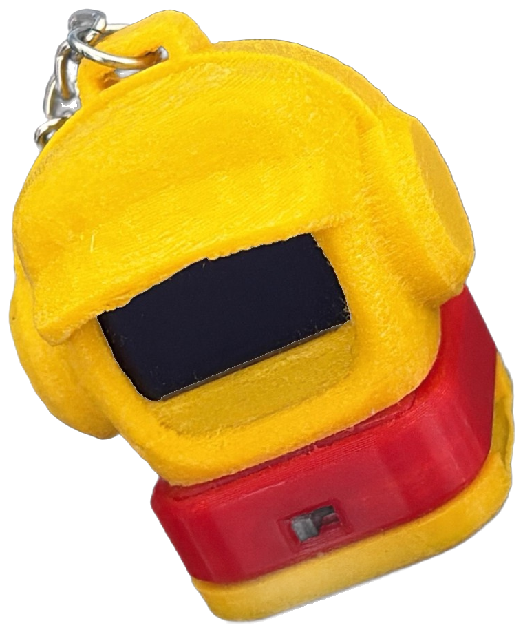

# RAFIQ



*rafiq* is Arabic for companion. A desk companion built on an ESP32-C3,
with a face, a clock, the weather, the prayer times, a shelf of short
reads, and a Bluetooth link to your phone.

You drive it by tapping the pad on the front, or by knocking on the desk
beside it.

**[How to use it](USING.md)** &nbsp;·&nbsp; **[Wiring](WIRING.md)**
&nbsp;·&nbsp; **[Decisions](DECISIONS.md)** &nbsp;·&nbsp;
**[Handover notes](HANDOFF.md)**

<br clear="right">

---

## What it does

### The face

- **21 watch faces.** Six laid out by hand, two that lean the way you lean
  and right themselves when you set it down, two with something that pours,
  three with hands, five that show what it knows about itself, two for
  showing off, and one for the Hijri calendar. Two knocks on the clock
  changes it.
- **Six eye styles**, animated, with blinks and idle glances.
- **Greeting** by name, either rotating or pinned to one line.

### What it knows

- **The time**, taken from your phone over Bluetooth and kept through
  sleep. No NTP, no WiFi.
- **Prayer times**, five a day with the next one picked out, each with its
  own correction in minutes because calculated times and the local masjid
  rarely agree. Friday midday is named Jumuah. Kept in flash, so they
  survive a network that is down.
- **The call in three steps.** Ten minutes out it says a word. Five minutes
  out it says it again and begins to flash. On the minute it flashes for a
  minute and leaves you alone.
- **Weather** from Open-Meteo, synced by the phone or the Mac.
- **Faith text carried in the firmware**: the tasbih counter, the 99 Names,
  and the morning and evening adhkar. None of it needs a network.
- **Short reads**, a shelf of stories kept in the filesystem. Four knocks
  writes a new one.

### Your phone

- **Notifications** over Apple's notification service, with a filter, a VIP
  list and a popup time.
- **Shortcuts.** A Shortcut named RAFIQ sends it a line: `home`, `sync`,
  `status`, `find me`, `timer 15`, `zikr`, `relax`, `night later` and a few
  dozen more, listed in [USING.md](USING.md#shortcuts-from-your-phone).
- **Phone guard.** It calls out if your phone leaves without you.
- **Auto away.** It goes quiet by itself when you do, and comes back when
  you return.
- **Reminders**, up to twenty, each with its own repeat. It nags every
  minute until you answer.

### Your Mac and your PC

A menu bar app for macOS and a tray app for Windows. Battery, the top three
tasks, what is playing, a screenshot, a volume knob, and a walk-away lock
that locks the Mac when the robot goes out of range.

### Itself

- **Battery reading** from a divider, with a history log and a settable
  full charge voltage, because packs do not all top out at 4.20V.
- **Processor speed**: auto, 80, 160 or 240 MHz.
- **Deep sleep** on a timer or on command, waking on touch or on movement.
- **Night sleep** at a bedtime you set.
- **Tamper alarm.** Arm it, and every movement is logged.
- **Safe mode.** Three crashes in a row and it comes up on WiFi so it can
  be updated.
- **OTA updates** from the app, from the robot itself, or from a file.

### Games

Six, played by tilting, two to a page: Snake, Brick, Car, Catch, Pong and
Roll. Best scores kept in flash.

### Keyring mode

It stops being a robot. No radios, 80 MHz, dark screen. Picked up, it opens
its eyes, says one line, and goes straight back to sleep. Six lines to
choose from and a seventh for whoever will not leave it alone.

It survives power cycles on purpose. The way back is a power cycle followed
by a four second hold on the pad, or a `home` from a Shortcut within two
minutes. See [USING.md](USING.md#keyring-mode).

---

## Driving it

The pad on the front, and optionally knocks on the desk.

| Hold the pad | Does |
|---|---|
| a tap | next |
| a hold, 0.7s by default | open |
| a longer hold, about 1.5s | back |
| four seconds | off |

Hold time is settable from 0.5s to 2.5s, and the other two move with it.

| Knocks | On a card | In a list | In a reader |
|---|---|---|---|
| 1 | next screen | next item | next page |
| 2 | go in | open it | back to the list |
| 3 | home | back out | back to the carousel |
| 4 | home | reload | reload |

Full details, every screen, every setting and every command are in
**[USING.md](USING.md)**.

## Bluetooth first, and WiFi almost never

Your iPhone is home. It gives the robot the time, the notifications, and
commands from a Shortcut.

**One setting decides the radio**: Settings, Phone and keyring,
Notifications.

| Notifications | Bluetooth |
|---|---|
| **off, daily** | the default. Up when you switch it on, takes the time, gone. Back once a day for a few seconds, with the screen dark, because the C3 has no crystal and the clock drifts |
| **on, linked** | up at boot and stays connected |

**Picking it up does not wake the radio.** It wakes the screen, and the
time it shows is its own. With the radio off, Shortcuts cannot reach it
and notifications do not arrive until the next time it is up: switch
Notifications on if you want them whenever you say them.

**WiFi is never on by itself.** Not at boot, not on a schedule, not as a
fallback. It comes up when you ask for it by name, and goes away again:

| How | WiFi lasts |
|---|---|
| `RAFIQ sync` | about a minute: clock, prayer times, weather, update check, a new read |
| Settings, Network, or `RAFIQ wifi` | until a real restart, or 30 min unused |
| Settings, Update, or `RAFIQ update` | while the update screen is open |
| Settings, Hotspot, or `RAFIQ config` | until 10 min after the last phone leaves |

## The config page

The only thing that raises WiFi on purpose. Join `RAFIQ-SETUP` and open
`192.168.4.1`. Your networks, reminders, vehicle dates, prayer corrections,
notification filters, VIPs, the shelf, your name and greeting, and firmware
upload.

## Screens

```
HOME  VEHICLE  REMINDERS  MAC  WEATHER  NOTIFICATIONS  PRAYER  FAITH
SHORT READS  GAMES  SETTINGS  SYSTEM
```

Plus three hubs opened from a Shortcut rather than by walking the list:
TODAY, FAITH and CALM.

## Settings

Six groups, so nothing is more than a few taps away.

| | |
|---|---|
| **Display** | brightness, watch face, clock, sleep, popup time, page turn, eye style, vehicle |
| **Phone and keyring** | notifications, keyring mode, card, network, multi-link, devices, pair a Mac, hotspot |
| **Touch and motion** | wake by, pocket lock, wake on hold, hold time, go back by, knocks, tap strength, accelerometer, motion sensor |
| **Away and safety** | auto away, phone guard, tamper alarm, tamper log |
| **Battery** | battery use, log, new log at, full charge, power down, processor, night sleep, bedtime |
| **System** | update, reset, reboot, about |

Prayer settings is a seventh group, opened from the FAITH screen, because
that is where you are when you want it.

## Building

| | |
|---|---|
| Board | ESP32C3 Dev Module |
| Partition scheme | **Minimal SPIFFS (1.9MB APP with OTA / 190KB SPIFFS)** |
| USB CDC On Boot | Enabled |
| Core | esp32 3.3.10 |
| Libraries | NimBLE-Arduino **2.5.1** (not 3.x), Adafruit GFX, Adafruit SSD1306, FluxGarage RoboEyes, ArduinoJson |

```
esp32:esp32:esp32c3:PartitionScheme=min_spiffs,CDCOnBoot=cdc
```

The sketch fills most of the 1.9MB slot, so the partition scheme is not
optional. Wiring, the reason for each pin, and the two things that catch
people out are in **[WIRING.md](WIRING.md)**.

Light sleep needs a patched core. Without it the robot runs, but the link
drops whenever the screen goes dark. See [HANDOFF.md](HANDOFF.md).

### Checking it before it ships

```
zsh tools/v6/run_tests.sh      # the parser and the state machines, on the host
python3 tools/v6/ui_check.py   # every screen, measured in pixels
python3 tools/v6/conn_check.py # every connection request, against Apple's rules
```

## Updating

| How | What to do |
|---|---|
| **the Rafiq app** | Check updates, then Update |
| **the robot** | Settings, System, Update, then hold. The newest release, or the last eight so an older one can go back |
| **a file** | the config page, Upload firmware, pick the APP `.bin` |

Putting an older build back is allowed on purpose, so there is always a way
off a release you did not get on with.

If it says **will not fit**, the board has a partition table whose OTA slot
is smaller than the build. Only USB can rewrite a partition table. Settings
and credentials live in NVS and survive it.

## Credentials

Nothing secret is committed. The binary attached to a release carries
placeholders only. Real credentials live in a gitignored `secrets.h` when
you build locally, and on the device in NVS, where an update cannot reach
them.
