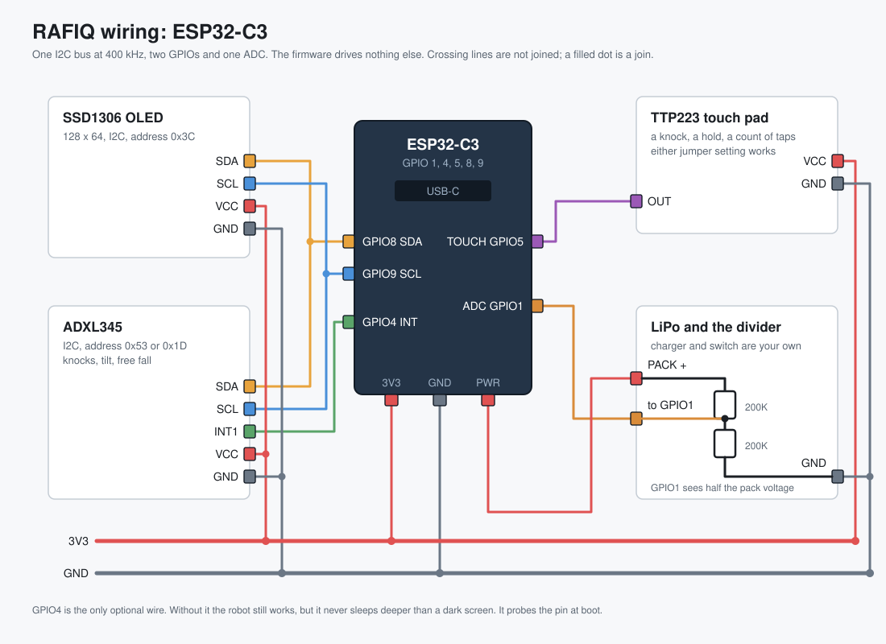

# Wiring



Everything shares one I2C bus at 400 kHz. Beyond that there are two GPIOs and
one ADC. The firmware drives nothing else: no buzzer, no LED, no vibration
motor.

## The pins

| ESP32-C3 | Goes to | Needed |
|---|---|---|
| **GPIO8** | SDA on the OLED and on the ADXL345 | yes |
| **GPIO9** | SCL on the OLED and on the ADXL345 | yes |
| **GPIO5** | OUT on the TTP223 touch pad | yes |
| **GPIO4** | INT1 on the ADXL345 | no, see below |
| **GPIO1** | the midpoint of a 200K / 200K divider across the pack | only for the battery reading |
| **3V3** | VCC on all three boards | yes |
| **GND** | GND on all three boards, and the bottom of the divider | yes |

They are defined in one place, [`nexus_face/nexus_face.ino`](nexus_face/nexus_face.ino):
`SDA_PIN` and `SCL_PIN` at line 84, `TAP_INT_PIN` at 96, `BATT_PIN` at 142,
`TOUCH_PIN` at 153.

### Why these pins and not others

The C3 can only wake from deep sleep on GPIO 0 to 5, which rules out most of
the chip for the two inputs that have to wake it. GPIO2, 8 and 9 are strapping
pins, so holding one at the wrong level at boot changes how the chip starts.
That leaves 8 and 9 for I2C, which is where they already are by default, and
GPIO4 and GPIO5 for the interrupt and the pad.

## I2C addresses

| Device | Address | Found by |
|---|---|---|
| SSD1306 OLED | `0x3C` | fixed |
| ADXL345 | `0x53`, then `0x1D` | `DEVID` reading `0xE5` |
| MPU6050 | `0x68`, then `0x69` | `WHO_AM_I` |

The MPU6050 is a fallback. Either sensor drives the face and the tilt, but
knocks, free fall and deep sleep wake all come from the ADXL345.

## GPIO4 is the only optional wire

Leave INT1 unwired and everything still works. What you lose is real sleep:
without it the robot never goes deeper than a dark screen, because nothing can
wake a processor that has been switched off.

It is **probed at boot**, not configured. The firmware enables the ADXL's
data ready interrupt, reads the pin twelve times, and calls it wired if at
least nine of those reads come back high. A floating pin does not read high
that consistently. One unit having the wire and another not is therefore not
something you have to keep track of, and not a build flag.

## The battery divider

Two 200K resistors from the pack to ground, with GPIO1 in the middle. The pin
sees exactly half the pack voltage, so a full cell lands near 2.1V, inside
what the ADC can read.

Three things worth knowing:

1. The firmware uses `analogReadMilliVolts`, not `analogRead`. It applies the
   calibration burned into the chip at the factory, which is worth about a
   hundred millivolts. A hundred millivolts is most of the difference between
   half full and nearly flat.
2. Two 200K resistors put 100K in front of the ADC, and this ADC would rather
   see something under 10K. It charges a small capacitor on each sample and
   100K refills it slowly, so the first read after a gap comes back low. The
   firmware reads several times and throws the first away. **If your numbers
   still look low, add 100nF from GPIO1 to ground.**
3. Packs do not all charge to 4.20V. Settings, Battery, Full charge sets what
   yours reads when full, and the whole percentage curve is scaled to it. The
   default is 4.10V.

How the pack is charged and switched is up to you and the board you used. The
firmware only ever reads the divider, and the divider has to share a ground
with the board.

## The touch pad

A TTP223, read as an ordinary digital input. The C3 has no capacitive touch
peripheral at all, unlike the original ESP32 and the S2 and S3, so a pad on
this chip means a small board that does its own sensing and hands over a level.

**Either solder jumper setting works, and you do not have to know which one
yours is in.** The two pads on the back of a TTP223 decide whether the output
goes high or low on touch, and whether it is momentary or latching: four
combinations, and the board does not say. So nothing is assumed. The resting
level is whatever the pin has held for the last minute, and a touch is
anything else. A pad spends almost all its life untouched, so the level it
sits at longest is the level it sits at, and that is true of all four
combinations.

This also recovers from the one thing that can go wrong. A TTP223 calibrates
itself in the first half second of power, so a finger on the pad while the
robot starts makes the chip treat a touched pad as its baseline. The level
read at boot is then the wrong one, and a minute later this notices and takes
the other one.

## Build settings

| | |
|---|---|
| Board | ESP32C3 Dev Module |
| Partition scheme | Minimal SPIFFS (1.9MB APP with OTA / 190KB SPIFFS) |
| USB CDC On Boot | Enabled |
| Core | esp32 3.3.10 |

```
esp32:esp32:esp32c3:PartitionScheme=min_spiffs,CDCOnBoot=cdc
```

The sketch fills 94 percent of the 1.9MB slot, so the partition scheme is not
optional. Libraries and checksums are in `FLASH.txt` inside the release zip.
